# Lights Out: Predicting Storm-Driven Power Outages and Recovery Across U.S. Counties

*ITE351 AI & Applications, Hanyang University, Fall 2026. Group project blog.*

**Members:**

| Name | University | Department | Email |
|---|---|---|---|
| Joshua HOORPAH | Ecole central d'electronique | Computer Science / Engineering | joshua.hoorpah@edu.ece.fr |
| Thierry ROSANO | Ecole central d'electronique | Computer Science / Engineering | Thierryrosano26@gmail.com |
| Erik Walter NIHLEN | Tekniska högskolan vid Linköpings universitet | Computer Science / Engineering | walni258@student.liu.se |
| Thomas LHUILLIER BETTIN | Ecole central d'electronique | Computer Science / Engineering | thomaslhuillier78@gmail.com |

## Abstract

When a storm hits the United States, some counties lose power for a few hours and others for weeks. Using a public
dataset of 672 storms from 2012 to 2026, which joins the outages reported by power utilities county by county with
satellite pictures of the lights at night, we train machine learning models for two questions: will a county have a
major outage (more than 10% of its customers without power), and how long will it take to bring 90% of them
back? We use only information available when the storm hits, and we always test the models on storms they have never
seen. Night light alone barely detects outages (AUC 0.56 to 0.60, where 0.5 is a coin flip). A random forest that
knows the storm type, the state, the date, the size of the county and whether it lies in the hurricane's wind radius
reaches an AUC of 0.71 on new storms, but it misses most major outages caused by floods. Predicting the restoration
time is much harder: storm-level information explains almost none of it, and knowing how many customers are out at the
peak explains about 20%. We describe each step, from the raw data to the errors of the final models.

## Table of contents

- [Abstract](#abstract)
- [I. Introduction](#i-introduction)
- [II. Datasets](#ii-datasets)
  - [Files](#files)
  - [Missing values and their reasons](#missing-values-and-their-reasons)
  - [Target 1: major outage](#target-1-major-outage)
  - [Target 2: hours to 90% restored](#target-2-hours-to-90-restored)
  - [Outages by storm type, state and year](#outages-by-storm-type-state-and-year)
- [III. Methodology](#iii-methodology)
- [IV. Evaluation & Analysis](#iv-evaluation--analysis)
- [V. Related Work](#v-related-work)
- [VI. Conclusion: Discussion](#vi-conclusion-discussion)
- [Appendix: How to run](#appendix-how-to-run)
- [References](#references)

## I. Introduction

### Motivation

Power outages are one of the most visible effects of a storm. When a hurricane, an ice storm or a line of
thunderstorms crosses the United States, falling trees and strong winds break power lines, and millions of homes can
lose electricity. Without power, people lose heating or air conditioning, food spoils, water pumps and medical devices
stop, and businesses close. The damage is very uneven: in some counties the lights are back within a few hours, in
others it takes weeks.

Power companies (*utilities*) and emergency services have to decide quickly where to send repair crews, generators
and help, often before they know the full extent of the damage. If we could tell in advance **which counties are
likely to lose power on a large scale**, and **how long it will take to restore it**, these decisions could be made
earlier and better. This is the question of our project.

### Two questions

We work at the level of a **county** (the United States has about 3,000 of them) during one storm. For each pair
"storm, county" we ask two questions:

1. **Will the county have a major outage?** We call an outage *major* when more than 10% of the county's customers
   (households and businesses connected to the grid) are without power at the worst moment of the storm, the
   *peak*. This is a yes/no question.
2. **How long will it take to bring the power back?** We measure the number of hours from the peak until 90% of
   the customers have power again. This is a question whose answer is a number.

### The data in a few words

We use a public dataset (Part II) that describes 672 storms declared as disasters by the U.S. federal emergency
agency (FEMA) between 2012 and 2026. For each storm and each county hit, it gives two views of the same blackouts:

- **what the utilities reported**: how many customers were out at the peak, and how fast they were reconnected;
- **what satellites saw**: how bright the county was at night before and after the storm. A county that suddenly
  goes dark from space may have lost power.

It also tells us the type of storm (hurricane, flood, winter storm...), its date, the state, and the number of
customers in each county.

### How we answer them

We use **supervised machine learning**: we show a model thousands of past examples (storm, county, what happened)
and it learns patterns that link the description of a storm and a county to the outcome. Then we ask it to predict
the outcome for examples it has not seen. In machine learning terms:

- question 1 is a **classification** task (predict a category: major outage or not);
- question 2 is a **regression** task (predict a number: hours of restoration).

We try several standard models from the scikit-learn library, from the simplest (logistic and linear regression,
which add up the effect of each feature) to more powerful ones that combine hundreds of small decision trees
(*random forests* and *gradient boosting*).

A few ideas guide the whole project, and they come back in every section:

- **Only use what is known in time.** A prediction is useless if it relies on information that only exists after
  the fact. To predict a major outage, the model may only use what is known when the storm hits (storm type, state,
  date, county size...), never the outage figures themselves.
- **Test on new storms.** All the counties hit by the same storm look alike (same weather, same date, same
  utility). If the model is trained on some counties of a storm and tested on others, it can simply recognise the
  storm and look better than it is. So we always keep whole storms aside for testing (*split by storm*), and our
  final scores come from storms the model has never seen.
- **Compare with simple baselines.** A score only means something next to a very simple rule, such as "always
  predict the most common answer" or "use the average of the storm type". A model is only useful if it clearly
  beats these rules.
- **Measure the quality in an understandable way.** For the yes/no question we mainly use the **AUC**: the
  probability that the model gives a higher risk score to a county that did have a major outage than to one that did
  not. An AUC of 0.5 is a coin flip, 1 is perfect. We also count the major outages found and the false alarms. For
  the restoration time we use the **R²**, the share of the differences between counties that the model explains
  (0 = no better than always predicting the average, 1 = perfect), and the typical error in hours.

We also test a question raised by the dataset itself: **can satellite night light alone detect an outage?** The
dataset authors found an AUC of only about 0.55, barely above chance, and we discuss why (clouds, generators that
switch lights back on before the grid, damaged buildings that stay dark).

### What the rest of this blog contains

- **Part II (Datasets)** describes the files, the missing values and the two targets, with the first charts.
- **Part III (Methodology)** explains step by step how we build the table, choose the features, train and test
  the models.
- **Part IV (Evaluation & Analysis)** gives the results on unseen storms and looks at where the models fail.
- **Part V (Related Work)** and **Part VI (Conclusion)** place the work in context and sum it up.

As a follow-up to this project, the models could be enriched with wind speed and pressure from NOAA HURDAT2, the
official record of Atlantic hurricanes, joined on the NOAA storm identifiers (for example AL022019), to measure how
much storm intensity improves them.

## II. Datasets

*In short: where the data comes from, what one row means, which values are missing and why, and what the two
things we want to predict look like.*

[Storm Blackout and Restoration](https://www.kaggle.com/datasets/heimdallresearch/storm-blackout)
v1.2 by Heimdall Research [1] (DOI [10.5281/zenodo.23010005](https://doi.org/10.5281/zenodo.23010005)).
It covers 672 FEMA-declared U.S. storms from 2012-01-14 to 2026-08-11 and gives, for each storm and
county, two views of the same blackouts:

- **Night light from space:** NASA Black Marble (VIIRS) [2] radiance before and after the storm.
- **Outages reported by utilities:** DOE EAGLE-I records [3] (from 2014-11 onward): peak customers out,
  share of customers out, customer-hours and restoration times.

### Files

| File in [`data/`](data/) | Rows | Content |
|---|---|---|
| `storms.csv` | 672 | One row per storm: id, name, type, landfall date, states |
| `county_summary.csv` | 51,493 | One row per storm and county: night-light summary and outage columns |
| `utility_by_county.csv` | 11,686 | Reported outages per storm and county, with `peak_share_out` and `hours_to_90pct_restored` |
| `validation_pooled.csv` | 51 | The authors' AUC of night-light measures against reported outages |

Column meanings are in [`data/DATA_DICTIONARY.md`](data/DATA_DICTIONARY.md) and known limits in
[`data/LIMITS.md`](data/LIMITS.md). The 3 GB `county_daily.csv` is not in this repository.

License: [CC BY 4.0](https://creativecommons.org/licenses/by/4.0/). Sources and attribution
(NASA Black Marble, EAGLE-I / ORNL, EIA, U.S. Census Bureau, OpenFEMA, NOAA NHC) are in
[`data/NOTICE.md`](data/NOTICE.md).

The exploration below comes from the notebook [`notebooks/01_eda.ipynb`](notebooks/01_eda.ipynb).

`storms.csv` has one row per storm. `event_id` is either a NOAA storm id (`AL022019` = 2nd Atlantic
storm of 2019, `EP…` = eastern Pacific) or a FEMA declaration number (`DR-4586`): 636 storms have a
FEMA number, 35 an Atlantic id and 1 an eastern Pacific id. `utility_by_county.csv` has one row per
storm and county, and holds the two targets. We join it to `storms.csv` on `event_id` to add storm
type and year to each county row (every row finds its storm).

| Storm type | Storms |
|---|---|
| severe_storm | 347 |
| flood | 186 |
| tropical | 36 |
| tornado | 24 |
| severe_ice_storm | 21 |
| winter_storm | 21 |
| snowstorm | 20 |
| typhoon | 8 |
| straight-line_winds | 6 |
| coastal_storm | 3 |

### Missing values and their reasons

In this dataset **an empty cell is never a zero**. Each column that can be empty has a `*_reason`
column that says why.

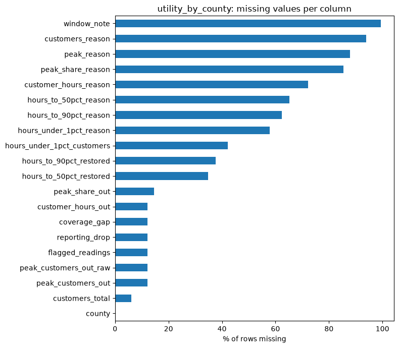

- `reason` = `no_utility_record` (1,048 rows) or `no_rows_in_window` (378 rows): EAGLE-I has no
  outage data for that county in the storm window. Both targets are empty and these rows cannot be
  used. 10,260 rows are `ok`.
- `peak_share_reason` = `peak_above_customer_estimate` (246 rows): more customers were reported out
  than the estimated customer count of the county (`customers_total` is an estimate from EIA-861 and
  Census housing units). The share is left empty instead of being above 100%.
- `hours_to_90pct_reason`:
  - `reporting_drop` (1,752 rows): the utility stopped reporting during the storm, so the restore
    time is unknown;
  - `not_restored_in_window` (1,165 rows): 90% was not reached before the end of the observation
    window. These are the **longest** restorations, so dropping them biases the regression target
    downwards. This is right-censoring, handled and discussed in the regression step. They are
    long in time but mostly **small** outages: about 150 customers out at the peak (median),
    against about 2,700 for the rows with a known value (see `03_regression.ipynb`);
  - `no_customers_out` (45 rows): nobody lost power, so there is nothing to restore.

The night-light columns of `county_summary.csv` follow the same logic. Their `status` column is
`no_measurable_outage` (15,688 rows), `cloud_obscured` (15,103), `low_signal` (14,078),
`light_drop` (4,879) or `insufficient_data` (1,745). 14 storms have no night light and 195 storms
have no outage run (117 of them because there is no utility record before 2014).

### Target 1: major outage

`peak_share_out` is the share of a county's customers out at the peak. A **major outage** is
`peak_share_out > 0.10`.

| | Value |
|---|---|
| Rows with a known share | 9,989 |
| Mean | 0.191 |
| Median | 0.098 |
| Max | 0.999 |
| Major (> 10%) | 4,950 |
| Not major | 5,039 |
| Unknown | 1,697 |
| Share of major outages among known rows | 49.6% |


The share is very skewed: most counties lose a few percent of customers, a long tail loses almost
all of them. The 10% threshold splits the known rows into two classes of similar size, so the
classification task is not strongly imbalanced.

### Target 2: hours to 90% restored

`hours_to_90pct_restored` is the number of hours until 90% of customers are back.

| | Value |
|---|---|
| Rows with a known value | 7,297 |
| Mean | 63.1 h |
| Median | 30.25 h |
| 75th percentile | 72 h |
| Max | 1,009.5 h |

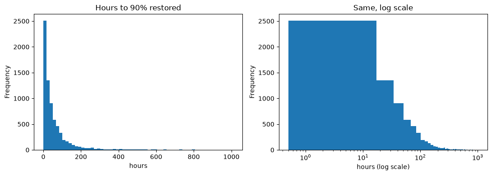

Restoration time also has a long right tail (up to about 1,000 hours). A log transform will
probably help the regression. Remember that the longest outages are partly missing
(`not_restored_in_window`), so the real tail is even longer.

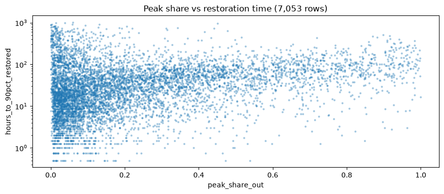

The two targets are only moderately related (Spearman correlation 0.292).

### Outages by storm type, state and year

| Storm type | Storms | County rows | Major outage rate | Median share out | Median hours to 90% |
|---|---|---|---|---|---|
| tropical | 33 | 4,412 | 0.487 | 0.094 | 30.0 |
| severe_storm | 230 | 3,763 | 0.533 | 0.114 | 29.6 |
| flood | 143 | 2,190 | 0.340 | 0.056 | 24.3 |
| severe_ice_storm | 14 | 671 | 0.813 | 0.302 | 50.5 |
| snowstorm | 19 | 268 | 0.274 | 0.036 | 19.5 |
| tornado | 21 | 201 | 0.545 | 0.110 | 23.3 |
| winter_storm | 10 | 133 | 0.710 | 0.203 | 52.3 |
| straight-line_winds | 4 | 43 | 0.879 | 0.332 | 52.3 |
| coastal_storm | 3 | 5 | 0.600 | 0.121 | 11.8 |

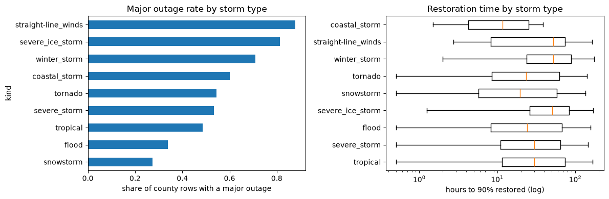

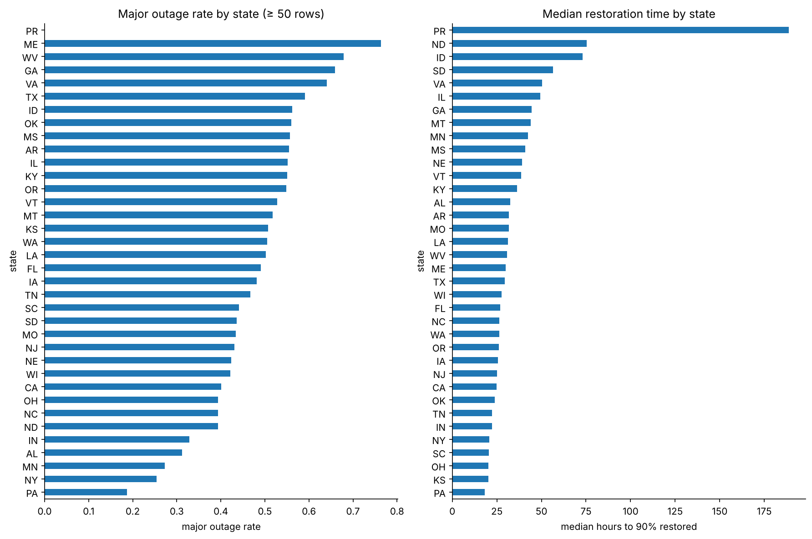

36 states have at least 50 county rows. The highest major outage rates are in Maine (0.764), West
Virginia (0.679), Georgia (0.659) and Virginia (0.640).

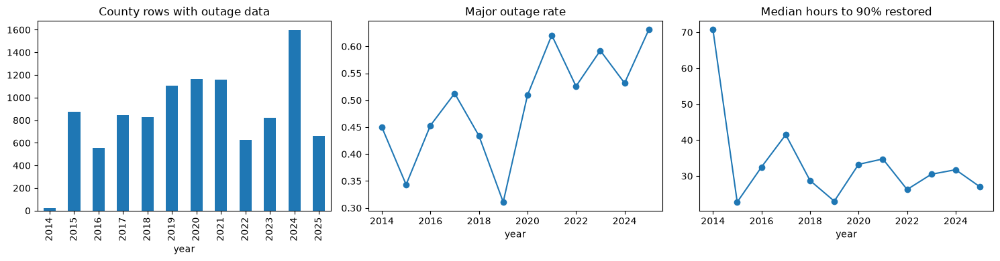

EAGLE-I county records start on 2014-11-01, so there is no outage data before 2014, and early
years have fewer counties covered. Year-to-year changes are driven by a few very large storms
(for example Irma in 2017 and Helene in 2024), so the year is more a proxy for which storms happened
than a trend.

## III. Methodology

*In short: we turn the data into one table (one row = one county during one storm), keep only the information
available at prediction time, compare simple rules with five machine learning models, and always score them on storms
kept aside. The same recipe is used for both questions.*

We follow the same procedure for both tasks, so the two models can be compared. The code is in
[`notebooks/02_classifier.ipynb`](notebooks/02_classifier.ipynb) (major outage) and
[`notebooks/03_regression.ipynb`](notebooks/03_regression.ipynb) (restoration time). Everything uses
scikit-learn.

### 1. Modelling table

One row = one storm in one county. We start from `utility_by_county.csv` and add:

- from `storms.csv` (joined on `event_id`): the storm type (`kind`), and the year and month of the
  landfall (or of the first impact when there is no landfall);
- from `county_summary.csv` (joined on `event_id` and `geoid`): whether the county is inside the NHC
  34-knot wind radius, and the median night-light radiance before the storm.

Every row of `utility_by_county.csv` finds its storm and its county, so the joins add no row and lose
none. We then keep the rows with `reason == 'ok'` (the utility reported something) and a known target:

| Task | Target | Usable rows | Storms |
|---|---|---|---|
| Classification | `major_outage` = `peak_share_out > 0.10` | 9,989 | 462 |
| Regression | `log(1 + hours_to_90pct_restored)` | 7,297 | 449 |

The regression target is modelled on the log scale because it spans 0.5 to 1,000 hours: on raw hours,
the model would be driven by a few extreme counties, and an error of 10 hours means more for a
3-hour outage than for a 300-hour one. On the log scale, an error is a relative error.

### 2. Features: only what is known when the prediction is needed

A prediction is only useful if it can be made before the answer is known. So each feature must be
available at the time of the prediction:

| Feature | Type | Known | Used in |
|---|---|---|---|
| `kind` (storm type) | categorical | before the storm | both tasks |
| `state` | categorical | before the storm | both tasks |
| `wind_radius`: inside / outside / unknown | categorical | when the storm hits | both tasks |
| `year`, `month` | numeric | before the storm | both tasks |
| `log_customers` = log(1 + `customers_total`), county size | numeric | before the storm | both tasks |
| `log_baseline` = log(1 + `baseline_radiance`), pre-storm night light (how urban the county is) | numeric | before the storm | both tasks |
| `log_peak` = log(1 + `peak_customers_out`) and `peak_share_out`, size of the outage | numeric | at the outage peak | regression, setup B only |

- The **classifier** uses the first seven features (the first six rows of the table, storm time): it must say whether a major outage
  will happen, so nothing about the outage itself can be used.
- The **regression** is run with two setups. **Setup A** uses the same storm-time features.
  **Setup B** adds the size of the outage at its peak. This is allowed because the restoration time
  is counted from the peak, so the peak is known when the prediction is made. It matches a real use:
  the utility knows how many customers are out and wants to know how long it will take.
- Left out on purpose because they contain part of the answer: `customer_hours_out`,
  `hours_to_50pct_restored`, `hours_under_1pct_customers`, and the night-light drop after the storm
  (`outage_min_ratio`, used only as a separate baseline for the classifier).
- The wind radius exists only for the 34 Atlantic storms covered by HURDAT2. An empty value does not
  mean "outside" (`data/DATA_DICTIONARY.md`), so it is kept as a third category, `unknown`.

### 3. Evaluation protocol: split by storm

All the counties hit by the same storm share the weather, the date and often the utility. If some of
them are used for training and others for testing, the model can recognise the storm instead of
learning something general, and the score is too optimistic. So:

1. **Final test set:** 20% of the storms are set aside at the start (`GroupShuffleSplit`, group =
   `event_id`) and used **only once**, at the very end.
2. **Model selection:** on the other 80%, 5-fold cross-validation where a storm is always entirely
   in one fold (`GroupKFold`). All comparisons and all tuning use these folds only.
3. **Check:** we also run one model with an ordinary random split, to measure how much a random
   split would overstate the score.

Metrics:

| Task | Main metric | Also reported |
|---|---|---|
| Classification | ROC AUC (0.5 = chance, 1 = perfect, does not depend on a threshold) | accuracy, precision, recall, F1 at threshold 0.5, confusion matrix |
| Regression | R² on log(hours) (0 = no better than the mean) | MAE on the log scale, shown as a typical error factor exp(MAE); median and mean absolute error in hours on the test set |

The two classes of the classifier have similar sizes (about 50/50), so accuracy is also meaningful
and no rebalancing is needed.

### 4. Baselines first

Before any model, very simple predictors show what "good" means:

- **Constant**: always the same prediction (the majority class, or the mean log time).
- **Storm-type lookup table**: the mean of the target for that storm type in the training folds.
- **Night light only** (classifier): how dark the county got after the storm, with no training. This
  tests our question of whether satellites alone can detect an outage.
- **Peak-size lookup table** (regression): the mean log time in 10 groups of outage size.

### 5. Models

Five classic models per task, from the simplest to the strongest on tabular data:

| Classification | Regression | Why |
|---|---|---|
| Logistic regression | Linear regression (ridge, small L2 penalty) | Linear baseline, readable coefficients |
| Gaussian Naive Bayes | k-nearest neighbours (k = 25) | Very simple, no real training |
| Decision tree (depth 5) | Decision tree (depth 6) | Can be drawn and explained |
| Random forest | Random forest | Robust with little tuning |
| Gradient boosting (`HistGradientBoostingClassifier`) | Gradient boosting (`HistGradientBoostingRegressor`) | Usually the best choice for tables |

Preprocessing is inside a scikit-learn `Pipeline`, so it is learned on the training folds only and
never sees the test data:

- linear models, Naive Bayes, k-NN and the trees: **one-hot encoding** of the categories (rare
  categories with fewer than 20 rows grouped together), **median imputation** of the few missing
  numbers, and **standard scaling** for the models that need it;
- gradient boosting: **ordinal encoding** with native categorical support, and native handling of
  missing values.

### 6. Tuning and final test

The two tree ensembles are tuned with a small `GridSearchCV` on the grouped folds (random forest:
leaf size and features per split; gradient boosting: learning rate, tree size and L2 penalty). The
grids are small on purpose: the goal is to show the procedure. The model with the best
cross-validated score is refitted on all training storms and evaluated once on the test storms.

### 7. Interpretation

- **Permutation importance** on the test storms: shuffle one feature and measure how much the score
  drops. It works on the original features (before one-hot encoding), so it is easy to read.
- A **shallow decision tree** (depth 3) to show the main rules of the classifier.
- For the regression, **predicted vs true** plots and **errors per storm type and per storm**.

### 8. Censored restoration times

1,165 counties were still above 10% of the peak when the 45-day window ended
(`not_restored_in_window`). Their true restoration time is unknown but longer than what was observed:
this is right-censoring. Dropping them makes the model under-estimate long restorations. We:

1. describe who is censored (outage size, storm type);
2. check how the model trained without them predicts them;
3. run a sensitivity check where they are kept with a stand-in value (the longest observed time,
   about 1,000 hours), and compare the results.

The proper method is survival analysis (Cox or accelerated failure time models, random survival
forests), which treats a censored row as "at least this long". We discuss it as an extension.
Counties with `reporting_drop` (the feed stopped) have an unknown time with no reason to be longer or
shorter, so they are simply dropped.

### 9. Future work: storm intensity from HURDAT2

Storm type is a weak description of how violent a storm was. For the storms with a NOAA id (`AL…`,
`EP…`), the natural follow-up is to join NOAA HURDAT2 maximum wind speed and minimum pressure on the
storm id, rerun the same protocol, and measure how much these features improve both models. This is
left for future work and is not part of the results below.

## IV. Evaluation & Analysis

*In short: how good the models are on storms they have never seen, compared with simple rules, and which storms
and counties they get wrong.*

### Major-outage classifier

The full analysis is in [`notebooks/02_classifier.ipynb`](notebooks/02_classifier.ipynb). The question is
whether more than 10% of a county's customers lose power at the peak, using only features known when
the storm hits.

**Cross-validation (training storms, split by storm).** Every model beats the simple baselines except
Naive Bayes. The random forest [11] is the best (ROC AUC 0.720), just ahead of logistic regression (0.706)
and gradient boosting (0.698). Using night light alone, with no model, gives an AUC of only 0.563,
barely above chance (0.5) and close to what the dataset authors report (0.52 to 0.57).

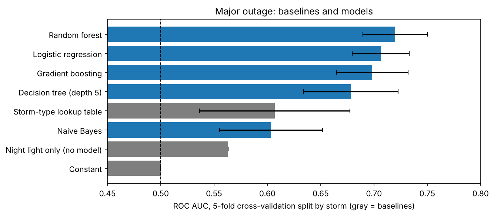

**Final test (93 storms never seen during training, 1,991 counties).** After a small tuning step, the
random forest reaches:

| Metric | Random forest | Reference |
|---|---|---|
| ROC AUC | **0.707** | night light only (no model): 0.600 on the same test storms, 0.563 on the training storms |
| Accuracy | 0.668 | always predicting the majority class: 0.522 |
| Precision | 0.637 | |
| Recall | 0.708 | |
| F1 | 0.671 | |

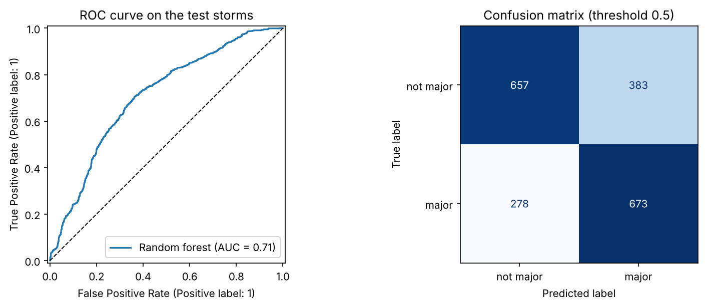

The test AUC (0.707) is close to the cross-validated one (0.720), so the model was not over-tuned to the
training storms. At a 0.5 threshold, it finds 71% of the major outages (673 of 951) but also raises 383
false alarms among the 1,040 counties without a major outage.

What we take from it:

- **Satellite night light alone is not enough to detect outages.** With an AUC of 0.56, it barely beats
  a coin flip. Clouds, generators that switch lights back on before the grid, and damaged buildings
  that stay dark all blur the signal (`data/LIMITS.md`).
- **A few features known at storm time do much better** (AUC 0.71 on unseen storms), but the model is far
  from perfect: storm and county descriptions only explain part of who loses power.
- The most useful features are the year, the NHC wind radius and the storm type (permutation
  importance in the notebook). The wind radius only exists for Atlantic storms, which is why adding
  HURDAT2 wind speed and pressure is the natural follow-up.
- The year comes first, which is unlikely to be a weather effect. The share of counties with a major outage
  rises from about 35% in 2015 to about 60% in 2021 to 2025. EAGLE-I coverage is incomplete in the
  early years (`data/LIMITS.md`), so part of the outages were not reported then, and the mix of storms
  also changes from year to year. The year mostly captures these changes in the data, so its
  importance should not be read as "outages get worse every year".
- Splitting by storm matters: the same gradient boosting model scores 0.698 when split by storm but
  0.793 with a random split, which would overstate how well it works on a new storm.

**Cross-validation vs test.** The tuned random forest scores between 0.678 and 0.770 on the five storm
folds, and its test AUC falls inside that range:

| | Cross-validation (5 storm folds) | Test (93 storms) |
|---|---|---|
| Random forest (tuned) | 0.721 ± 0.032 (folds: 0.678 to 0.770) | 0.707 |
| Logistic regression | 0.706 ± 0.027 | |
| Gradient boosting | 0.698 ± 0.033 | |
| Storm-type lookup table | 0.607 ± 0.070 | |
| Night light only (no model) | 0.563 (training storms) | 0.600 |

The spread between folds is large: depending on which storms are held out, the AUC moves by almost 0.1. With only
about 90 storms per fold, a single test score should be read with that uncertainty in mind.

**Choosing the decision threshold.** The model outputs a probability, and the label depends on the threshold.
Missing a major outage (no crews sent) costs more than a false alarm (crews on standby for nothing), so 0.5 is not
necessarily the right choice. On the test storms (1,991 counties, 951 major outages):

| Threshold | Precision | Recall | F1 | Major outages found | False alarms |
|---|---|---|---|---|---|
| 0.3 | 0.521 | 0.958 | 0.675 | 911 of 951 | 836 |
| 0.4 | 0.564 | 0.848 | 0.678 | 806 of 951 | 622 |
| 0.5 | 0.637 | 0.708 | 0.671 | 673 of 951 | 383 |

Going from 0.5 to 0.4 finds 133 more major outages for 239 more false alarms, so it is worth it as soon as a missed
major outage costs more than about 1.8 false alarms, which is likely for a utility planning its crews. At 0.3 the
model flags almost every county (836 false alarms out of 1,040 counties without a major outage). The F1 score barely
moves (0.67 to 0.68): the choice depends on the cost of each error, not on the model. This table is shown for
illustration; in practice the threshold would be chosen on the training folds, and all the other results keep 0.5.

**Errors per storm.** Counties of the same storm share the weather, so the model tends to be right or wrong for a
whole storm at once. Among the 47 test storms with at least 5 major outages, the median recall per storm is 0.88,
but 13 storms are below 0.5 and 8 have a recall of 0.

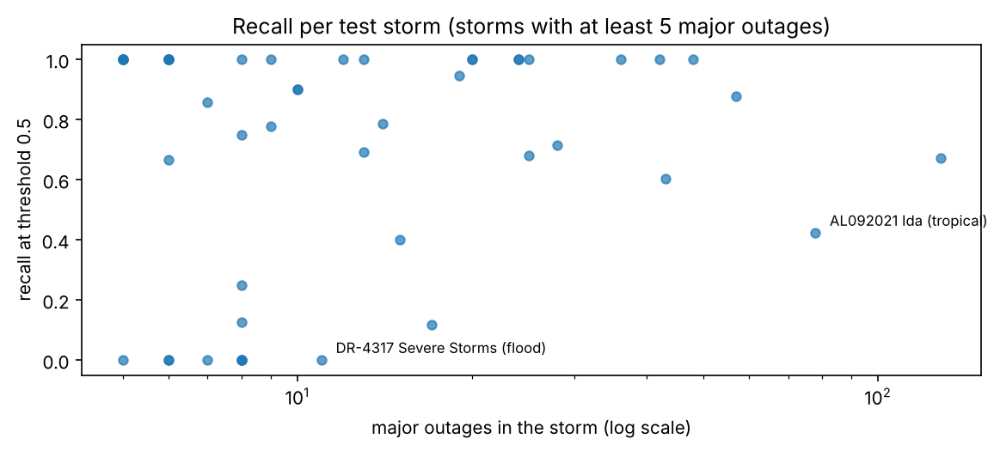

- **By storm type**, the recall is 0.88 for severe storms, 0.65 for tropical storms, 0.24 for floods and 0.07 for
  snowstorms. 7 of the 8 storms where the model finds no major outage at all are floods (for example DR-4317,
  Missouri, 2017: 11 major outages, none found). Floods cause a major outage in only 34% of their counties (Part II),
  so the model learns to predict "not major" for them.
- **The storm with the most missed major outages is Hurricane Ida (2021):** 45 missed out of 78. The model found all
  33 major outages *inside* the NHC wind radius and none of the 45 *outside* it: counties of Mississippi and Louisiana
  outside the 34-knot radius, and New Jersey, Pennsylvania and New York, hit by Ida's remnants as flooding. In the
  training storms, only 31% of tropical-storm counties outside the radius have a major outage, against 69% inside,
  so the model relies on the radius. Ida shows the limit of this rule: a storm can still cause large outages outside
  the radius, and only wind speed or rainfall data could separate these cases.

**Results per storm type.** The same test predictions, grouped by storm type (threshold 0.5; *major share* is the share of counties with a
major outage):

| Storm type | Storms | Counties | Major share | Precision | Recall | F1 |
|---|---|---|---|---|---|---|
| Severe storm | 48 | 724 | 55% | 0.62 | 0.88 | 0.73 |
| Tropical storm | 7 | 701 | 51% | 0.65 | 0.65 | 0.65 |
| Flood | 32 | 430 | 27% | 0.68 | 0.24 | 0.35 |
| Ice storm | 2 | 75 | 71% | 0.71 | 1.00 | 0.83 |
| Snowstorm | 3 | 38 | 37% | 0.50 | 0.07 | 0.12 |
| Tornado | 1 | 23 | 35% | 0.47 | 1.00 | 0.64 |

The model works best on severe storms and ice storms, and worst on floods and snowstorms, where it finds less than a
quarter of the major outages. The rarer types have only one to three test storms, so their scores mostly describe
those few storms.

**Top-K: where to send crews first.** A utility does not need a yes/no answer for every county as much as a ranking:
which counties to check first. We sort the 1,991 test counties by predicted risk and look at the top of the list:

| Counties checked first | Counties | Major outages among them | Hit rate | Share of all major outages found |
|---|---|---|---|---|
| 5% | 100 | 65 | 65% | 7% |
| 10% | 199 | 144 | 72% | 15% |
| 20% | 398 | 264 | 66% | 28% |
| 30% | 597 | 411 | 69% | 43% |

Picking counties at random gives a hit rate of 48% (the share of major outages in the test storms). The top 10% of
the ranking reaches 72%: one and a half times better than chance. The hit rate stays around 66% to 69% further down
the list, so the ranking is useful at the top but does not separate the counties sharply.

**Is the model only learning the year?** The year is the most important feature, and Part II showed that early years
are under-reported in EAGLE-I. To check that the model does not only learn this, we retrain the tuned random forest
without the year, and we also train on the storms up to 2022 and test on the storms from 2023 onward, which mimics
using the model on future storms:

| Features | CV AUC (5 storm folds) | Test AUC (93 storms) | Future storms (train up to 2022, test 2023+) |
|---|---|---|---|
| With year | 0.721 ± 0.032 | 0.707 | 0.675 |
| Without year | 0.695 ± 0.030 | 0.678 | 0.657 |

Removing the year costs about 0.03 of AUC, and the model still clearly beats night light alone (0.56 to 0.60) and the
storm-type lookup table (0.61). So the year helps, but most of the signal comes from the storm and the county. On
future storms the AUC drops to about 0.66 to 0.68: 2023 to 2025 have more major outages (57% of the counties against
46% before), and a model trained on the past under-estimates this level. In practice the model would need to be
retrained each season.

### Restoration-time regression

The full analysis is in [`notebooks/03_regression.ipynb`](notebooks/03_regression.ipynb). The question is how many
hours it takes, from the peak of the outage, until 90% of the customers have power again. The target is modelled as
log(1 + hours), so the errors are relative ("off by a factor of 2"). We compare two sets of features (Part III):
**setup A** uses only what is known when the storm hits, as for the classifier; **setup B** adds the size of the
outage at its peak (number and share of customers out), which is known when the restoration starts.

**Cross-validation (training storms, split by storm).** R² on log(hours), and the typical error factor exp(MAE):

| Model | Setup A (storm time) | Setup B (at the peak) |
|---|---|---|
| Constant (mean) | -0.012 (x2.79) | |
| Storm-type lookup table | -0.008 (x2.76) | |
| Peak-size lookup table (10 groups) | | 0.078 (x2.62) |
| Linear regression (ridge) | 0.028 (x2.71) | 0.084 (x2.58) |
| k-nearest neighbours | -0.023 (x2.77) | 0.175 (x2.45) |
| Decision tree (depth 6) | 0.008 (x2.73) | 0.189 (x2.40) |
| Random forest | 0.028 (x2.70) | **0.218 (x2.36)** |
| Gradient boosting | 0.003 (x2.73) | 0.186 (x2.39) |

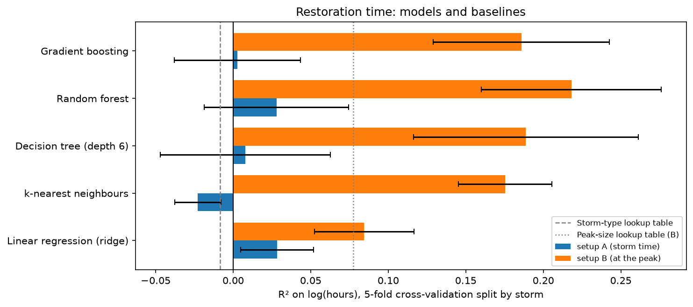

- **With storm-time features only, no model beats the constant in a useful way** (best R² 0.03). Storm type, state,
  date and county size tell us whether a county loses power (AUC 0.71 above), but almost nothing about how long it
  stays dark.
- **The size of the outage is what matters.** A lookup table on the peak size alone, with no model, already beats
  every setup A model, and the tree ensembles of setup B reach an R² of about 0.2.
- The linear model gains much less from setup B than the trees (0.084 against 0.19 to 0.22): the effect of the peak
  size is not a straight line, and trees capture it more easily.

**Two choices checked.**

| Check | Result (cross-validation, setup B) |
|---|---|
| Random forest trained on raw hours vs log hours, errors measured in hours | median error 27.7 h vs **17.9 h**, mean error 50.5 h vs **44.7 h** |
| Gradient boosting, split by storm vs random split | R² **0.186** vs 0.250 |

The log target gives a better model even when the errors are counted in hours: trained on raw hours, the forest is
pulled up by the few 500 to 1,000-hour restorations and over-predicts the many short ones. As for the classifier, a
random split looks better because counties of the same storm restore at similar speeds; we keep the split by storm.

**Final test (90 storms never seen during training, 1,263 counties).** After a small tuning step, the best model of
each setup is tested once:

| Model | R² (log) | Error factor | Median error | Mean error | Within a factor of 2 |
|---|---|---|---|---|---|
| Constant (training mean) | 0.00 | x2.79 | 22.0 h | 50.1 h | |
| Setup A: random forest | 0.05 | x2.74 | 19.8 h | 49.7 h | 41% |
| Setup B: gradient boosting | **0.21** | **x2.42** | **16.2 h** | **45.2 h** | **50%** |

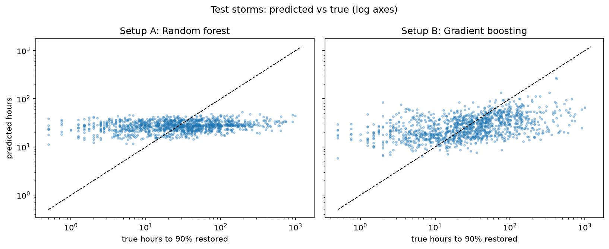

The test scores are close to the cross-validated scores of the tuned models (0.05 and 0.21 against 0.05 and 0.23),
so the models were not over-tuned. The scatter plots show the limits clearly. Setup A predicts almost the same 17 to 39 hours for every
county (5th to 95th percentile of its predictions). Setup B spreads its predictions more (12 to 62 hours), but it is
still cautious: short restorations are over-predicted and long ones under-predicted. Even the best model leaves
about 80% of the variance unexplained, and only half of its predictions are within a factor of 2 of the truth.

**What the model relies on.** Permutation importance of the setup B model on the test storms (drop in R² when a
feature is shuffled): share of customers out at the peak 0.176, number of customers out 0.165, county size 0.029,
state 0.025; storm type, year, month, wind radius and night light each 0.005 or less. Once the size of the outage is
known, the description of the storm adds almost nothing.

**Errors per storm type.**

| Storm type | Test storms | Counties | Error factor | Mean residual (log) |
|---|---|---|---|---|
| Severe storm | 50 | 589 | x2.43 | +0.08 |
| Tropical storm | 7 | 356 | x2.08 | +0.04 |
| Flood | 26 | 262 | x2.93 | -0.12 |
| Winter storm | 2 | 18 | x2.16 | +0.52 |
| Snowstorm | 2 | 16 | x2.59 | +0.19 |
| Straight-line winds | 1 | 10 | x2.43 | +0.15 |

A positive residual means the restoration took longer than predicted.

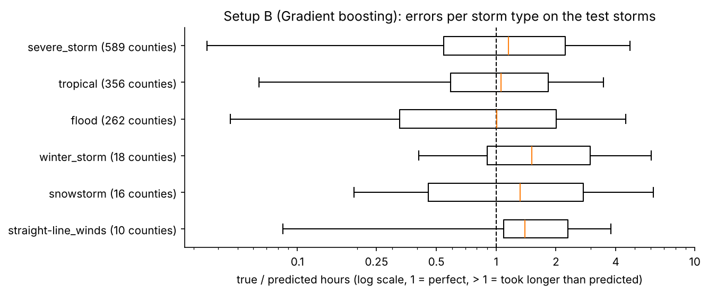

- **Tropical storms are predicted best** (error factor 2.1): their counties are numerous and similar.
- **Floods are predicted worst** (error factor 2.9), with the widest spread of errors. They are also the storm type with
  the highest share of censored counties (below).
- **Winter storms and snowstorms take longer than predicted**, but the test set has only two storms of each type,
  so these numbers mostly describe those storms.
- **Errors are shared by whole storms**, as for the classifier. The worst case is DR-4557 (severe storms in Iowa,
  2020): its median county took 124 hours to recover and the model predicted about 32 hours for most of them.
  Nothing in our features describes how violent that storm was.

**The censored counties.** 1,165 counties with utility data were still above 10% of the peak when the 45-day window
ended (`not_restored_in_window`), so their true restoration time is unknown and longer than observed. The model is
trained without them. They are not the large outages we expected after the exploration:

| Group | Counties | Median customers out at the peak | Median share out | Median customers in the county |
|---|---|---|---|---|
| Known restoration time | 7,297 | 2,733 | 13.8% | 17,481 |
| Censored (`not_restored_in_window`) | 1,165 | 153 | 1.9% | 7,118 |
| Feed stopped (`reporting_drop`) | 1,752 | 1,129 | 6.0% | 16,823 |

A typical censored county is a small outage where a handful of customers stay out for weeks: 10% of a 150-customer
peak is 15 customers. Floods (22% of their counties) and snowstorms (20%) are censored at the highest rate, tropical
storms (5%) at the lowest; in absolute numbers, severe storms have the most censored counties because they have many
more rows.

- On the 203 censored counties of the test storms, the model predicts a median of 50 hours, against 25 hours for the
  known counties: it already sees them as longer, but predicts more than a week for only 2% of them.
- Keeping the 935 censored training counties with a stand-in value of 1,010 hours (the longest observed time) raises
  their predicted median to 212 hours, but lowers the test R² on the known counties from 0.21 to 0.12: the stand-in
  is too crude.

So our regression describes **restorations completed within the 45-day window**, and slightly under-estimates
restoration times, mostly for floods. Survival analysis, which treats a censored county as "at least this long", is
the proper way to use these rows (Part VI).

What we take from it:

- **Predicting how long the power stays out is much harder than predicting whether it goes out.** With storm-time
  features only, the R² is about 0.05 on new storms, almost no better than always predicting the average.
- **Knowing how many customers are out at the peak is the key information**: R² 0.21, a typical error factor of 2.4
  and a median error of 16 hours, against 22 hours for the constant.
- **Most of the difference between counties remains unexplained.** What is missing is what makes repairs slow:
  storm intensity, physical damage to the network, available crews, flooded or blocked roads.

## V. Related Work

- **Dataset authors' validation of night light.** The dataset authors scored night-light measures
  against reported outages ([`data/validation_pooled.csv`](data/validation_pooled.csv),
  [`data/LIMITS.md`](data/LIMITS.md)). County mean darkness has a pooled AUC of 0.515 (418 storms,
  5,841 counties), lit-pixel radiance drop 0.559 and change in the share of unlit lit-mask pixels
  0.566 (287 storms, 3,611 counties). An AUC of 0.5 is chance.
- **Outage prediction for storms.** Statistical models of hurricane and ice-storm outages using wind, network and
  land-cover data [7], hurricane outage forecasts for storm response planning [8], and models of outage duration
  [9]. These studies use detailed utility network data for one region; we only have open county-level data for
  the whole country, which explains part of the gap in accuracy.
- **Data sources:** NASA Black Marble, EAGLE-I / ORNL, EIA, U.S. Census Bureau, OpenFEMA, NOAA NHC
  (see [`data/NOTICE.md`](data/NOTICE.md)).
- **Tools and libraries:** Python, pandas, matplotlib, scikit-learn [4], Jupyter (see
  [`requirements.txt`](requirements.txt)).

## VI. Conclusion: Discussion

*In short: what we can answer, what limits the answer, and what we would do next.*

### What we found

- **Whether a county will have a major outage can be predicted, but only moderately well.** With features known when
  the storm hits, a tuned random forest reaches an AUC of 0.707 on 93 storms it has never seen (0.721 in
  cross-validation), against 0.56 to 0.60 for satellite night light alone and 0.61 for a storm-type lookup table. Used
  as a ranking, the 10% of counties it flags first contain 72% of major outages, against 48% at random.
- **How long the restoration takes is much harder.** With the same storm-time features, no model really beats a
  constant prediction (R² about 0.05 on unseen storms). Knowing the size of the outage at its peak helps a lot: R² about
  0.21, with a median error of about 16 hours instead of 22 hours for the constant.
- **Night light from space is not a reliable outage detector on its own** (AUC 0.52 to 0.57, as the dataset authors
  found): clouds, generators and damaged buildings blur the signal.
- **Splitting by storm is essential.** A random split overstates both models (AUC 0.79 instead of 0.70, R² 0.25 instead
  of 0.19), because counties of the same storm look alike.

### Limits

- **The data.** EAGLE-I covers only part of the customers in the early years, so the target itself changes over time;
  the year is the most important feature partly for this reason. The 34-knot wind radius exists only for tropical
  storms, and there is no wind speed, rainfall or network damage for the other storm types.
- **Censoring.** Restoration times longer than the 45-day window are unknown, and we model only completed
  restorations.
- **The evaluation.** A single test split of about 90 storms, with fold-to-fold variations of almost 0.1 of AUC. Errors
  are shared by whole storms: floods and storms like Ida, whose damage falls outside the wind radius, are missed
  as a block.
- **Time.** Trained up to 2022, the classifier loses about 0.03 of AUC on storms from 2023 onward.

### Future work

- **Storm intensity from NOAA HURDAT2** [10] (maximum wind and minimum pressure), joined on the NOAA storm identifiers, to
  measure how much intensity improves both models, in particular for tropical storms like Ida.
- **Survival analysis** (Cox models, random survival forests, with `lifelines` [5] or `scikit-survival` [6]) to use the
  censored counties as "at least this long" instead of dropping them.
- **Retraining each season** and choosing the decision threshold from the cost of a missed outage against a false
  alarm, as a utility would do in practice.

## Appendix: How to run

Everything runs on a laptop in a few minutes, from the repository root. The step-by-step guide (virtual
environment, Windows commands, checks and common problems) is in [`SETUP.md`](SETUP.md), and the exact package
versions we used are in [`requirements-lock.txt`](requirements-lock.txt). In short:

```bash
pip install -r requirements-lock.txt
cd notebooks
for nb in 0*.ipynb; do   # 01 to 04, in order
  jupyter nbconvert --to notebook --execute --inplace $nb
done
```

- **Notebooks.** `01_eda` explores the data (Part II), `02_classifier` (about 5 minutes) and `03_regression` (about
  1 minute) train and evaluate the models (Parts III and IV), and `04_report_figures` redraws every figure of this
  report into `figures/` without retraining anything.
- **Results.** `02_classifier` saves its numbers in `results/` (cross-validation scores, test predictions, thresholds,
  results per storm, per storm type, top-K and the year check), so the tables of Part IV can be checked without
  rerunning it. `03_regression` does the same (`results/regression_*`: cross-validation and test scores, test
  predictions, errors per storm type and per storm, permutation importance and the censoring checks) and saves its
  three figures (`figures/regression_*.png`).
- **Reproducibility.** The data is in `data/` (dataset v1.2, unchanged). All random steps use seed 0: the storm split
  (`GroupShuffleSplit`, 20% of the storms kept for the test), the folds and the models. With scikit-learn 1.9 we get
  the numbers above; other versions can move the third decimal.
- **Two-column PDF.** The IEEE version of this report is built from this README with pandoc and LaTeX (IEEEtran):
  `python3 report/build.py . report`, then `pdflatex lights-out-ieee.tex` twice in `report/`.

## References

[1] Heimdall Research, "Storm Blackout and Restoration," dataset, version 1.2, 2026. doi: 10.5281/zenodo.23010005.

[2] M. O. Román *et al.*, "NASA's Black Marble nighttime lights product suite," *Remote Sens. Environ.*, vol. 210,
pp. 113–143, 2018. doi: 10.1016/j.rse.2018.03.017.

[3] Oak Ridge National Laboratory, "EAGLE-I county outage records," Figshare, 2023. doi: 10.6084/m9.figshare.24237376.

[4] F. Pedregosa *et al.*, "Scikit-learn: Machine learning in Python," *J. Mach. Learn. Res.*, vol. 12,
pp. 2825–2830, 2011.

[5] C. Davidson-Pilon, "lifelines: Survival analysis in Python," *J. Open Source Softw.*, vol. 4, no. 40, p. 1317,
2019.

[6] S. Pölsterl, "scikit-survival: A library for time-to-event analysis built on top of scikit-learn," *J. Mach.
Learn. Res.*, vol. 21, no. 212, pp. 1–6, 2020.

[7] H. Liu, R. A. Davidson, and T. V. Apanasovich, "Spatial generalized linear mixed models of electric power outages
due to hurricanes and ice storms," *Reliab. Eng. Syst. Saf.*, vol. 93, no. 6, pp. 897–912, 2008.

[8] S. D. Guikema *et al.*, "Predicting hurricane power outages to support storm response planning," *IEEE Access*,
vol. 2, pp. 1364–1373, 2014.

[9] R. Nateghi, S. D. Guikema, and S. M. Quiring, "Forecasting hurricane-induced power outage durations," *Nat.
Hazards*, vol. 74, no. 3, pp. 1795–1811, 2014.

[10] C. W. Landsea and J. L. Franklin, "Atlantic hurricane database uncertainty and presentation of a new database
format," *Mon. Weather Rev.*, vol. 141, no. 10, pp. 3576–3592, 2013.

[11] L. Breiman, "Random forests," *Mach. Learn.*, vol. 45, no. 1, pp. 5–32, 2001.
