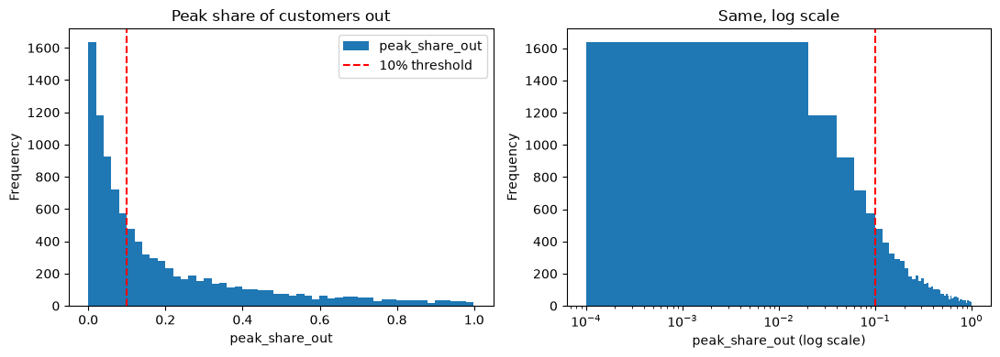

# Lights Out: Predicting Storm-Driven Power Outages and Recovery Across U.S. Counties

*ITE351 AI & Applications, Hanyang University, Fall 2026. Group project blog.*

**Members:**

| Name | University | Department | Email |
|---|---|---|---|
| Joshua HOORPAH | Ecole central d'electronique | Computer Science / Engineering | joshua.hoorpah@edu.ece.fr |
| Thierry ROSANO | Ecole central d'electronique | Computer Science / Engineering | Thierryrosano26@gmail.com |
| Erik Walter NIHLEN | Tekniska högskolan vid Linköpings universitet | Computer Science / Engineering | walni258@student.liu.se |
| Thomas LHUILLIER BETTIN | Ecole central d'electronique | Computer Science / Engineering | thomaslhuillier78@gmail.com |

## Table of contents

- [I. Introduction](#i-introduction)
- [II. Datasets](#ii-datasets)
  - [Files](#files)
  - [Missing values and their reasons](#missing-values-and-their-reasons)
  - [Target 1: major outage](#target-1-major-outage)
  - [Target 2: hours to 90% restored](#target-2-hours-to-90-restored)
  - [Outages by storm type, state and year](#outages-by-storm-type-state-and-year)
- [III. Methodology](#iii-methodology)
- [IV. Evaluation & Analysis](#iv-evaluation--analysis)
- [V. Related Work](#v-related-work)
- [VI. Conclusion: Discussion](#vi-conclusion-discussion)

## I. Introduction

### Motivation

When a storm hits the United States, some counties lose power for a few hours and others for
weeks. We want to know which county and storm features explain that difference.

### What we want to see at the end

Using 672 FEMA-declared storms from 2012 to 2026, we will train two supervised models at the
county level. The first is a classifier that flags major outages, defined as more than 10% of
customers out at the peak (`peak_share_out > 0.10`). The second is a regression model that
predicts `hours_to_90pct_restored`, the time needed to bring 90% of customers back. We will also
test whether satellite night light alone can detect an outage: the dataset authors report an AUC
of only about 0.55, barely above chance, and we will discuss why (generators, clouds, damaged
buildings). Finally, we will add wind speed and pressure from NOAA HURDAT2, joined on the NOAA
storm identifiers (for example AL022019), and measure how much they improve the models.

## II. Datasets

[Storm Blackout and Restoration](https://www.kaggle.com/datasets/heimdallresearch/storm-blackout)
v1.2 by Heimdall Research (DOI [10.5281/zenodo.23010005](https://doi.org/10.5281/zenodo.23010005)).
It covers 672 FEMA-declared U.S. storms from 2012-01-14 to 2026-08-11 and gives, for each storm and
county, two views of the same blackouts:

- **Night light from space:** NASA Black Marble (VIIRS) radiance before and after the storm.
- **Outages reported by utilities:** DOE EAGLE-I records (from 2014-11 onward): peak customers out,
  share of customers out, customer-hours and restoration times.

### Files

| File in [`data/`](data/) | Rows | Content |
|---|---|---|
| `storms.csv` | 672 | One row per storm: id, name, type, landfall date, states |
| `county_summary.csv` | 51,493 | One row per storm and county: night-light summary and outage columns |
| `utility_by_county.csv` | 11,686 | Reported outages per storm and county, with `peak_share_out` and `hours_to_90pct_restored` |
| `validation_pooled.csv` | 51 | The authors' AUC of night-light measures against reported outages |

Column meanings are in [`data/DATA_DICTIONARY.md`](data/DATA_DICTIONARY.md) and known limits in
[`data/LIMITS.md`](data/LIMITS.md). The 3 GB `county_daily.csv` is not in this repository.

License: [CC BY 4.0](https://creativecommons.org/licenses/by/4.0/). Sources and attribution
(NASA Black Marble, EAGLE-I / ORNL, EIA, U.S. Census Bureau, OpenFEMA, NOAA NHC) are in
[`data/NOTICE.md`](data/NOTICE.md).

The exploration below comes from the notebook [`notebooks/01_eda.ipynb`](notebooks/01_eda.ipynb).

`storms.csv` has one row per storm. `event_id` is either a NOAA storm id (`AL022019` = 2nd Atlantic
storm of 2019, `EP…` = eastern Pacific) or a FEMA declaration number (`DR-4586`): 636 storms have a
FEMA number, 35 an Atlantic id and 1 an eastern Pacific id. `utility_by_county.csv` has one row per
storm and county, and holds the two targets. We join it to `storms.csv` on `event_id` to add storm
type and year to each county row (every row finds its storm).

| Storm type | Storms |
|---|---|
| severe_storm | 347 |
| flood | 186 |
| tropical | 36 |
| tornado | 24 |
| severe_ice_storm | 21 |
| winter_storm | 21 |
| snowstorm | 20 |
| typhoon | 8 |
| straight-line_winds | 6 |
| coastal_storm | 3 |

### Missing values and their reasons

In this dataset **an empty cell is never a zero**. Each column that can be empty has a `*_reason`
column that says why.

- `reason` = `no_utility_record` (1,048 rows) or `no_rows_in_window` (378 rows): EAGLE-I has no
  outage data for that county in the storm window. Both targets are empty and these rows cannot be
  used. 10,260 rows are `ok`.
- `peak_share_reason` = `peak_above_customer_estimate` (246 rows): more customers were reported out
  than the estimated customer count of the county (`customers_total` is an estimate from EIA-861 and
  Census housing units). The share is left empty instead of being above 100%.
- `hours_to_90pct_reason`:
  - `reporting_drop` (1,752 rows): the utility stopped reporting during the storm, so the restore
    time is unknown;
  - `not_restored_in_window` (1,165 rows): 90% was not reached before the end of the observation
    window. These are the **longest** outages, so dropping them biases the regression target
    downwards. This is right-censoring, which we will need to handle (or at least discuss) in the
    regression step;
  - `no_customers_out` (45 rows): nobody lost power, so there is nothing to restore.

The night-light columns of `county_summary.csv` follow the same logic. Their `status` column is
`no_measurable_outage` (15,688 rows), `cloud_obscured` (15,103), `low_signal` (14,078),
`light_drop` (4,879) or `insufficient_data` (1,745). 14 storms have no night light and 195 storms
have no outage run (117 of them because there is no utility record before 2014).

### Target 1: major outage

`peak_share_out` is the share of a county's customers out at the peak. A **major outage** is
`peak_share_out > 0.10`.

| | Value |
|---|---|
| Rows with a known share | 9,989 |
| Mean | 0.191 |
| Median | 0.098 |
| Max | 0.999 |
| Major (> 10%) | 4,950 |
| Not major | 5,039 |
| Unknown | 1,697 |
| Share of major outages among known rows | 49.6% |

The share is very skewed: most counties lose a few percent of customers, a long tail loses almost
all of them. The 10% threshold splits the known rows into two classes of similar size, so the
classification task is not strongly imbalanced.

### Target 2: hours to 90% restored

`hours_to_90pct_restored` is the number of hours until 90% of customers are back.

| | Value |
|---|---|
| Rows with a known value | 7,297 |
| Mean | 63.1 h |
| Median | 30.25 h |
| 75th percentile | 72 h |
| Max | 1,009.5 h |

Restoration time also has a long right tail (up to about 1,000 hours). A log transform will
probably help the regression. Remember that the longest outages are partly missing
(`not_restored_in_window`), so the real tail is even longer.

The two targets are only moderately related (Spearman correlation 0.292).

### Outages by storm type, state and year

| Storm type | Storms | County rows | Major outage rate | Median share out | Median hours to 90% |
|---|---|---|---|---|---|
| tropical | 33 | 4,412 | 0.487 | 0.094 | 30.0 |
| severe_storm | 230 | 3,763 | 0.533 | 0.114 | 29.6 |
| flood | 143 | 2,190 | 0.340 | 0.056 | 24.3 |
| severe_ice_storm | 14 | 671 | 0.813 | 0.302 | 50.5 |
| snowstorm | 19 | 268 | 0.274 | 0.036 | 19.5 |
| tornado | 21 | 201 | 0.545 | 0.110 | 23.3 |
| winter_storm | 10 | 133 | 0.710 | 0.203 | 52.3 |
| straight-line_winds | 4 | 43 | 0.879 | 0.332 | 52.3 |
| coastal_storm | 3 | 5 | 0.600 | 0.121 | 11.8 |

36 states have at least 50 county rows. The highest major outage rates are in Maine (0.764), West
Virginia (0.679), Georgia (0.659) and Virginia (0.640).

EAGLE-I county records start on 2014-11-01, so there is no outage data before 2014, and early
years have fewer counties covered. Year-to-year changes are driven by a few very large storms
(for example Irma in 2017 and Helene in 2024), so the year is more a proxy for which storms happened
than a trend.

## III. Methodology

We will compare simple baselines (logistic and linear regression) with tree ensembles such as
random forests and gradient boosting.

What the exploration tells us for the modelling step:

- The modelling table is `utility_by_county.csv` joined to `storms.csv` on `event_id`.
- Rows with `reason != 'ok'` have no outage data and are dropped for modelling.
- **Classification** (`peak_share_out > 0.10`): about 10,000 usable rows, two classes of similar size.
- **Regression** (`hours_to_90pct_restored`): about 7,300 usable rows, long right tail (use a log
  target), and right-censored rows (`not_restored_in_window`) to handle.
- Storm type, state and year all show large differences and are natural first features.
- Only the storms with a NOAA id (`AL…`, `EP…`) can be enriched with HURDAT2 wind speed and pressure.

*In progress.*

## IV. Evaluation & Analysis

*In progress.*

## V. Related Work

- **Dataset authors' validation of night light.** The dataset authors scored night-light measures
  against reported outages ([`data/validation_pooled.csv`](data/validation_pooled.csv),
  [`data/LIMITS.md`](data/LIMITS.md)). County mean darkness has a pooled AUC of 0.515 (418 storms,
  5,841 counties), lit-pixel radiance drop 0.559 and change in the share of unlit lit-mask pixels
  0.566 (287 storms, 3,611 counties). An AUC of 0.5 is chance.
- **Data sources:** NASA Black Marble, EAGLE-I / ORNL, EIA, U.S. Census Bureau, OpenFEMA, NOAA NHC
  (see [`data/NOTICE.md`](data/NOTICE.md)).
- **Tools and libraries:** Python, pandas, matplotlib, Jupyter (see
  [`requirements.txt`](requirements.txt)).

## VI. Conclusion: Discussion

*In progress.*
